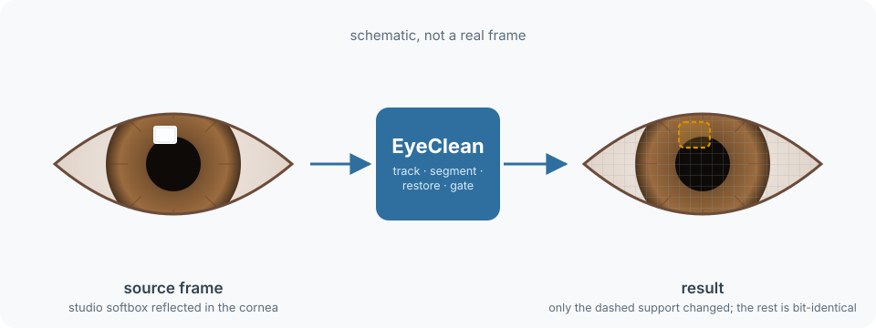
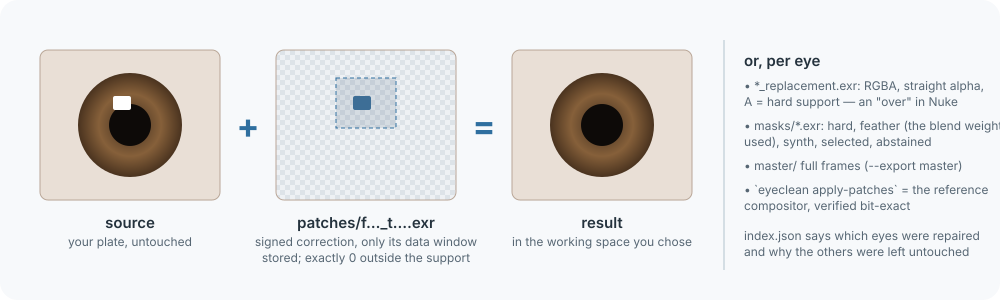
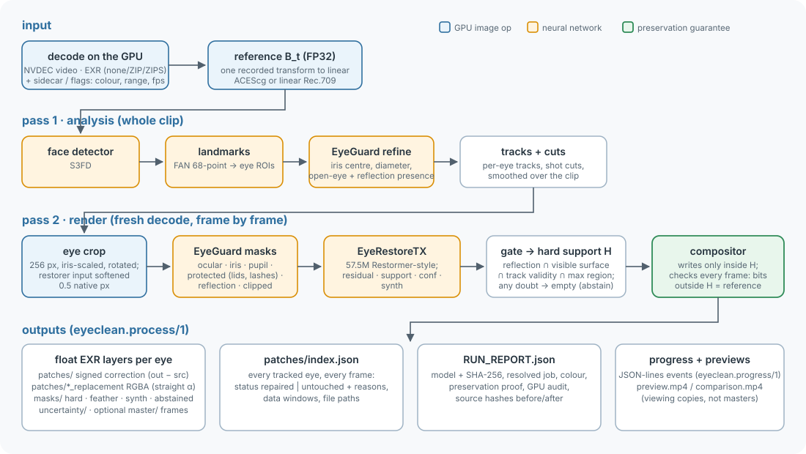
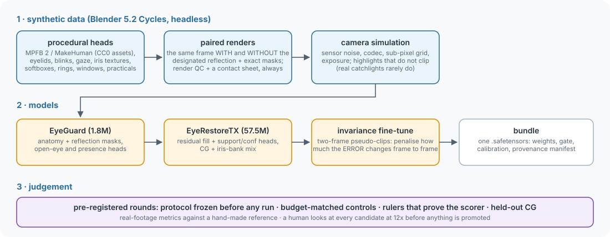

# EyeClean

**Remove studio catchlights and reflections from eyes in video, on the GPU, without touching anything else.**



When a subject is filmed in front of a softbox, LED wall or window, that light shows up in their eyes.  If the shot is
then relit or put into a new environment (virtual production, green screen, a relight in comp), the old reflection gives
the plate away.  EyeClean finds the eyes, removes the designated reflection and rebuilds the iris and pupil underneath.
It changes **only** those pixels; every other pixel of the frame stays bit-identical.  It is steady from frame to frame,
because judging that has been most of the work.

> **What kind of model it is.**  EyeClean is a supervised image-to-image restoration model, trained only on synthetic
> paired renders: the same eye with and without the studio light's reflection.  After off-the-shelf face and landmark
> detection, two networks run on a 256 px crop of each eye:
> - a small CNN, a convolutional U-Net with 1.8M parameters, segments the iris, pupil, lids and the reflection;
> - a 57.5M-parameter convolutional transformer predicts the repaired pixels as a residual correction.  It follows
>   Restormer: a U-shaped stack of transformer blocks whose attention runs across channels rather than pixels, with every
>   projection done by convolutions, so there are no patches or tokens.
>
> A rule-based gate applies that correction only inside a hard mask.  It is deterministic, not generative: no diffusion,
> no GAN.

- **Preservation guarantee.**
  - Every frame is checked on the GPU: outside the final edit support, the IEEE-754 bit pattern of every output pixel
    equals the decoded source.
  - The run fails otherwise, and the input files are hashed before and after.
- **Compositor-friendly output.**
  - Signed float EXR corrections (output − source) with tight data windows, plus RGBA replacements, masks and
    uncertainty.
  - A per-frame, per-eye index says which eyes were repaired and why the others were left alone.
  - Nothing is baked in; full-frame masters are optional.
- **Colour-managed.**
  - Declared input colour: linear ACEScg, linear Rec.709, Rec.709, sRGB or Panasonic V-Log / V-Gamut.
  - One recorded transform into an FP32 linear working space; limited range is never guessed.
- **Temporally stable.**
  - The restorer is fine-tuned to make the same fill when only the sampling grid, noise or catchlight position changes.
  - On the development shot it removes 78-87% (two scorers) of the frame-to-frame instability its predecessor added,
    measured against a hand-made reference fix.
- **Callable from anything.**
  - A versioned job / progress / output contract, a CLI with stable exit codes and a Python API.
  - A dependency-free client for Blender, Nuke and pipeline Pythons ([docs/INTEGRATION.md](docs/INTEGRATION.md)).
- **GPU all the way.**
  - NVDEC decode, CUDA models, GPU compositing and GPU EXR packing.
  - A strict audit fails a run on any CPU numerical fallback.

> **Status: research release, one real shot.**  EyeClean has been developed against held-out synthetic data and a
> single real 1080p shot, which a human reviewed frame by frame at 12x.  Read [the model card](MODEL_CARD.md) before
> relying on it.  Test on your own footage.  It runs on NVIDIA GPUs only and has been tested on Windows 11 with an
> RTX 5080.

## Quick start

```powershell
git clone <repo> eyeclean; cd eyeclean
./bootstrap.ps1                                   # uv sync --frozen, face-detector weights, quick doctor (Linux: ./bootstrap.sh)
uv run eyeclean models --fetch                    # the default model, eyeclean-r54 (239 MB), SHA-256 verified
```

**A photo** (JPEG, PNG, WebP, TIFF, ...; any size; colour and orientation are read from the file):
```powershell
uv run eyeclean fix IMG_1234.jpg                  # writes IMG_1234.eyeclean.jpg next to it
```

**A video file** (H.264 / HEVC / AV1 / VP9, 8-12 bit):
```powershell
uv run eyeclean process interview.mp4 --input-color rec709 --input-range limited --output out/interview
```

**An EXR sequence** from your comp or keying stage (uncompressed, ZIP or ZIPS; timing must be given):
```powershell
uv run eyeclean process "plates/sh042/fg/%06d.exr" --input-color linear-acescg --fps 24000/1001 --output out/sh042 --export patches,report --exr-compression zip
```

**A job file, with progress for a pipeline or farm:**
```powershell
uv run eyeclean process --job sh042.eyeclean.json --progress jsonl
```

**From Python** in the engine's environment:
```python
from eyeclean.api import process
res = process("interview.mp4", "out/interview", input_color="rec709", input_range="limited", on_progress=print)
print(res.summary["eye_status_counts"])            # e.g. how many eye-frames were repaired vs left untouched
```

**From any other Python** (Blender, Nuke, a 3.13 pipeline) via [`clients/python`](clients/python):
```python
from eyeclean_client import run, RunOutput
out = RunOutput(run({"input": "fg/%06d.exr", "output": "sh042_eyeclean", "input_color": "linear-rec709", "fps": "24"}).output)
```

## What you get



```text
out/sh042/
  RUN_REPORT.json          complete-run marker: model + SHA-256, the resolved job, colour, preservation proof, per-eye counts
  patches/index.json       every frame, every tracked eye: "repaired" or "untouched" (+ why), data windows, file paths
  patches/f000123_t000.exr               signed correction, working space; add it to the plate
  patches/f000123_t000_replacement.exr   RGBA (straight alpha): the repaired pixels, A = hard support
  masks/f000123_t000.exr                 hard, feather, synth, selected, abstained
  uncertainty/f000123_t000.exr           1 - the network's reconstruction confidence
  master/frame_000123.exr                optional full frames (--export master)
  preview.mp4, comparison.mp4            optional viewing copies (--export preview)
```

- **In Nuke:**
  - Read the patch in the job's working space.
  - `Merge (plus)` it onto the plate.
  - Or `Premult` the replacement and `Merge (over)`.
- **In code:** `result[y0:y1, x0:x1] = source[y0:y1, x0:x1] + correction`.
- **Reference compositor:** `eyeclean apply-patches` is the reference compositor and verifies itself bit-exact.

## How it works



**Two GPU passes:**
1. **Analysis** decodes the whole clip once:
   - faces (S3FD) → 68 landmarks (FAN) → eye regions;
   - EyeGuard refines each iris and says whether an open eye with a visible designated reflection is present;
   - eyes are tracked across the clip, with cut detection and smoothing.
2. **Render** decodes the clip again and, per eye and frame:
   - crops a 256 px, iris-scaled, rotated window;
   - EyeGuard segments anatomy (iris, pupil, protected lids and lashes, reflection, clipped);
   - EyeRestoreTX, a 57.5M-parameter Restormer-style transformer, predicts the repaired pixels with support and
     confidence;
   - a conservative gate intersects the reflection with the visible eye surface, the track's validity and any
     user-supplied region;
   - the compositor writes only inside that hard support, then proves it.

**Uncertain eyes abstain.**  A closed, occluded, too-small or doubtful eye is left bit-exact.  It is reported with a
reason, never guessed.

More: [docs/ARCHITECTURE.md](docs/ARCHITECTURE.md).

## How it was built



- **Trained on synthetic data only**: CG renders plus a bank of generated iris images, with no real footage.
  - Procedural heads (MPFB 2 / MakeHuman) are rendered in Blender Cycles as exact pairs: the same frame with and without
    the designated reflection.
  - The camera is simulated: noise, codec, sub-pixel sampling, exposure.
  - Highlights are rendered so they do not clip, because real catchlights rarely do.
- **Judged under pre-registration.**  Across more than 50 development rounds:
  - every experiment freezes its protocol and pass bars before it runs;
  - every change is compared against a budget-matched control;
  - every metric is first shown to measure what it claims ("rulers");
  - a human looks at every candidate zoomed in before anything is promoted.
- **Many ideas failed.**  They are recorded, not hidden.
- The guide to the approach, including what did not work and why: [docs/APPROACH.md](docs/APPROACH.md).

## Documentation

| | |
|---|---|
| [docs/INTEGRATION.md](docs/INTEGRATION.md) | calling EyeClean from pipelines, apps, farms and other languages: job files, progress, outputs, exit codes |
| [docs/ARCHITECTURE.md](docs/ARCHITECTURE.md) | the system: passes, models, gate, preservation, GPU policy, bundle format, code map |
| [docs/APPROACH.md](docs/APPROACH.md) | why it is built this way: synthetic data, temporal stability, the evaluation discipline, the failures |
| [MODEL_CARD.md](MODEL_CARD.md) | the released model: intended use, data, evaluation, limitations, licences |
| [docs/integrations/blender-virtual-production.md](docs/integrations/blender-virtual-production.md) | worked integration into a virtual-production pipeline |
| [CONTRIBUTING.md](CONTRIBUTING.md) · [CHANGELOG.md](CHANGELOG.md) · [SECURITY.md](SECURITY.md) · [CODE_OF_CONDUCT.md](CODE_OF_CONDUCT.md) · [THIRD_PARTY_NOTICES.md](THIRD_PARTY_NOTICES.md) | |

## Requirements

- An NVIDIA GPU with a CUDA 13 driver and about 4 GB free.
  - Developed on an RTX 5080.  Other GPUs the CUDA 13 PyTorch build supports should work, but are untested.
- Windows 11 (tested).  Linux (untested).
- [`uv`](https://docs.astral.sh/uv/).
- Blender ≥ 5.2 is needed only to generate training data (`./bootstrap.ps1 -Training`), not to process footage.
- Inputs: NVDEC-decodable video or scanline EXR sequences.  ProRes, DNxHR and RAW must be exported to EXR or HEVC first.

## Licence

- **MIT:** EyeClean's code and documentation, and the released model weights (`eyeclean-r54`, and `eyeclean-r48` before it).  See [LICENSE](LICENSE).
- **GPL-3.0-or-later:** the Blender data-generation scripts (`blender/`), because they drive MPFB.
- **Third-party assets and weights** carry their own terms: the face-detector weights, fetched at install; the iris
  dataset the model was trained on.  See [THIRD_PARTY_NOTICES.md](THIRD_PARTY_NOTICES.md) and
  [MODEL_CARD.md](MODEL_CARD.md#licences).
