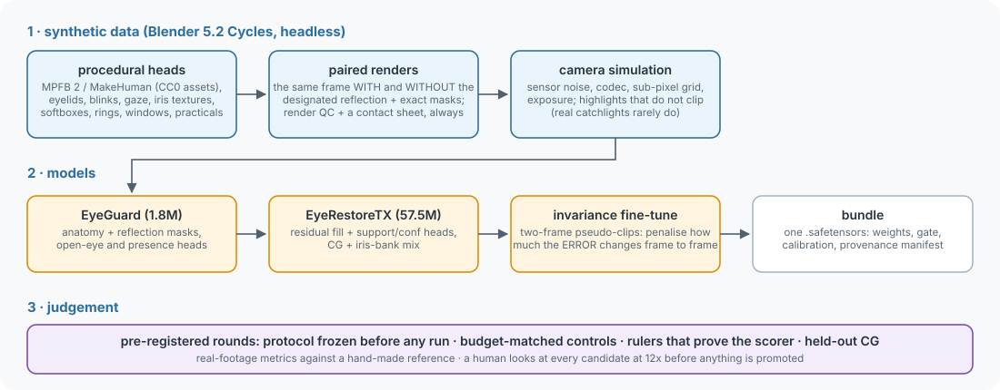

# The approach: how EyeClean was built, and what we learned

This is a guide to *why* EyeClean looks the way it does.  The maintainers keep a detailed record, one document per
development round (52 so far).  It is not published, because it is built around private footage.  This page is the
short version, failures included.

## The problem, stated precisely

**The task:** remove a *designated* reflection (the studio light you are replacing) from the cornea.  Rebuild the iris
and pupil it covered.  Change nothing else.

**Three constraints shaped everything:**
1. **Preservation is absolute.**  A removal that touches skin, lashes or the other eye's pixels is unusable in a VFX
   pipeline.  So the system is a *gate* around a network, not a network alone.  Edits happen only inside a hard
   support, and that is proven bit for bit on every frame.  When unsure, it abstains.
2. **There is no paired real data.**  Nobody has the same take with and without the softbox in the eye.  So training
   data is synthetic: Blender Cycles renders of procedural heads (MPFB 2), each rendered twice, with and without the
   designated reflection, with exact masks.
3. **Video is judged in motion.**  A fill that is plausible on every still can still "boil" when played.  Most of the
   later work went into temporal stability, and into learning how to *measure* it honestly.

## Synthetic data: close the gaps you can measure

- **Render the regime you will meet.**  Early CG catchlights clipped to white in 74% of cases; real catchlights on the
  development footage almost never do.  The renderer was fixed to produce unclipped highlights; the textures were left
  alone.  Real-footage capability jumped.  Rounds 18-19.
- **Frame the eye the same way in training and inference.**  Both used "2.75 iris diameters", but training measured
  the diameter differently.  Its eyes were 1.59× too small.  Round 21.
- **Include what reality contains.**  The CG bank had no closed or half-closed eyes, so blinks were out of
  distribution.  Round 21.
- **Define the task the data teaches.**  A restorer trained to remove *all* veiling light also "removed" it from clean
  eyes: 47% of its correction fired on eyes with no catchlight.  Targets were changed to remove only the designated
  catchlight, with shared flare left in.  That fixed the whole eye.  Rounds 21-22.
- **Validate renders before training on them.**  Run a render QC and *look at a contact sheet*.  The checker itself
  was wrong twice.  36% of one training split turned out to be noise-dominated.
- **Train long enough before concluding anything.**  A 60,000-update run showed the restorer had been underfit all
  along.  Earlier "nulls" at 2,000-5,000 updates were budget-confounded.  Round 16.

## The model

The architecture is described in [ARCHITECTURE.md](ARCHITECTURE.md).  In brief:
- **The guard** knows the anatomy: what is iris, pupil or lid, where the catchlight is, and what must never be
  edited.  It was EyeGuard, a small U-Net; since `eyeclean-r57` it is GuardTX, a transformer with the restorer's
  architecture, initialised from the restorer and trained to EyeGuard's outputs.
- **EyeRestoreTX**, a Restormer-style transformer, makes the fill.  It replaced a CNN once the CNN's limits were
  measured rather than assumed.
- **A conservative gate** decides where the fill may go.

**Fill in place, don't transplant.**  Inpainting with a pretrained LaMa, copying iris texture from elsewhere in the
frame, and a per-shot "canonical iris" atlas were all tried:
- some scored well on stills;
- the reviewer rejected some in motion ("the pupil moves around like it's trying to chase a target").

## Temporal stability: what actually worked

The fill's frame-to-frame instability ("boil") was attacked from many sides.

| idea | result |
|---|---|
| temporal adapters and memory (feed the previous output back) | **null**: the model never used the memory.  The CG bank was all single-frame stills, so there was no temporal signal to learn from (Rounds 29, 35) |
| oracle geometry (tell the net where the pupil edge is) | **fail**: error down 11%, boil not (Round 34) |
| is the boil sensor noise? | **no**: plate noise explains 12-22% of the fill's change (Round 36) |
| is it the catchlight moving over the iris? | **no, closed** (Round 39) |
| sampling: band-limited crop extraction | only a sinc sampler is truly shift-equivariant on the eye; the network *amplifies* sub-pixel phase changes of its input (Round 37) |
| **soften the restorer's input by 0.5 native px** | **+42-47% of the removable boil, every guard passing** → shipped (Rounds 41-43) |
| test-time ensembles (shifts, flips) | the network is already shift-equivariant; flips help the metric, but the reviewer could not see it (Round 44) |
| **invariance fine-tune**: two-frame CG "pseudo-clips" where only the sampling grid, noise, codec and tracker jitter change, with a loss on how much the *error* changes between them | **78-87% of the removable boil** (from 42-47%) → shipped as the current model (Rounds 45-46, 48) |
| heavier invariance weight | measurably steadier (+8-10 points) but **invisible** to the reviewer, and the fill brightened (Round 49) |
| re-graining the fill to match the plate | rejected by the reviewer (Round 51) |

**What remains** (Round 50):
- The fill changes frame to frame about as much as the real iris beside it, but as slow, low-frequency blotches.
- It has less fine grain than the real iris.
- Zoomed in, a careful eye still sees it; at normal size the reviewer is unsure.

## The discipline: how we avoided fooling ourselves

Most of the lessons here are about **measurement**.  Every one was learned the hard way.

1. **Pre-register.**
   - Freeze the protocol, the arms, the bars and the decision rule in a JSON file before anything runs.
   - Never lower a threshold after seeing results.
   - Amend only before the affected step runs.
2. **Controls.**
   - Every training intervention runs beside a budget-matched control: same data, batches, steps and seed, in one
     process.
   - A step-1 identity check proves the arms really start equal.
3. **Rulers.**
   - Before a metric judges anything, push a known answer through it: the target itself, the source, a hand-made
     reference fix.
   - The metric must score these as it should.  Several did not.
4. **Look.**
   - Watch 12 consecutive frames at 12× zoom before and after measuring.
   - A mean frame-difference once said "stable" while a speck blinked at the top of the fill.
5. **Know the metric's blind spots.**  Each of these fooled us once:
   - a one-sided metric that clamped the deficit scored dug holes as perfect removal;
   - luminance-only metrics are blind to colour;
   - a mean frame-to-frame difference is blind to boil;
   - a scorer that resamples measures its own resampling;
   - a difference-to-reference metric has a floor: the reference's own change.  Score a static fill first;
   - near that floor, a "share of what is removable" magnifies a 3% absolute change into 10 points;
   - a per-pixel mean ignores spatial scale: slow blotches look far worse than fine grain of the same size.
6. **The human is the judge.**
   - Metrics decide which candidates are worth showing.
   - A person watching the footage decides what ships.
   - When the two disagree, the metric is re-examined.

## What we would do next

- **Accept the caller's eye tracks** (limbus fits, facial capture) instead of the built-in detector.  This helps both
  consistency with a host pipeline and licensing.
- **Temporal training data:** real multi-frame CG clips rather than two-frame pseudo-clips, now that the measurement
  can tell whether it helps.
- **More real footage:** validate beyond the single development shot.  Especially large irises (4K+, anamorphic),
  hard head turns and wet eyes.
- **A clean-licence retrain** of the restorer on textures whose licences allow redistribution (see
  [MODEL_CARD.md](../MODEL_CARD.md#licences)).
