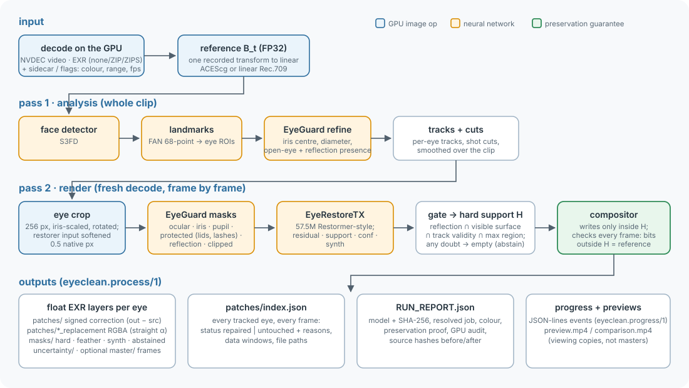

# EyeClean architecture



EyeClean is one engine, `eyeclean process`, run over one clip.  The clip is decoded twice: an analysis pass builds eye
tracks over the whole clip, and a render pass repairs and writes each frame.  Everything numerical runs on the GPU.
The design is organised around one promise: **pixels outside the final edit support are never changed, and that is
proven on every frame.**

## 1. The reference

- **Decode:**
  - Video is decoded by NVDEC (PyNvVideoCodec): H.264, HEVC, AV1, VP9, 8-12 bit, 4:2:0 / 4:2:2 / 4:4:4.
  - EXR sequences are read by EyeClean's own strict reader: scanline, single-part, none / ZIP / ZIPS, HALF / FLOAT.
    The CPU parses headers and runs zlib; the byte de-filtering, unpacking and dtype conversion run on CUDA.
- **Interpretation:** the input's colour, range and matrix come from flags, a sidecar or stream metadata.  They are
  never guessed.  From them, one recorded transform converts the decoded codes to FP32 linear in the working space
  (ACEScg by default, or linear Rec.709).
- **The reference B_t:** that FP32 array is the *reference*.  Preservation is measured against it, bit for bit.  Source
  alpha is carried separately and verified unchanged.  Source files are hashed before and after the run.

Code: `io/video.py`, `io/exr.py`, `io/sequence.py`, `io/sidecar.py`, `color/transforms.py`, `inference/frames.py`.

## 2. Pass 1: analysis (the whole clip)

Per frame:
1. A detector proxy image goes to **S3FD** faces (up to 4), then **FAN** 68-point landmarks, giving eye regions.
2. **EyeGuard refine** finds the iris centre and diameter, and scores the presence of an open eye and of a visible
   designated reflection.
3. A **cut detector** starts new shots.
4. An **eye tracker** links eyes across frames.

After the clip:
- The tracks are **smoothed**.  The crop geometry then does not jitter with per-frame detection noise, which is a large
  share of what makes an eye edit shimmer.

Code: `tracking/detector.py`, `tracking/networks.py` (adapted from face-alignment, BSD-3), `tracking/tracker.py`,
`inference/pipeline.py: Pipeline.analyze`.

## 3. Pass 2: render (frame by frame, fresh decode)

For every tracked eye in the frame:

| step | what | why |
|---|---|---|
| crop | 256 × 256 px, K = 2.75 iris diameters wide, rotated to the eye's axis; bilinear from the reference | a resolution-independent view: the network always sees the eye at the same scale |
| soften | the restorer's input only: the frame region is Gaussian-blurred by σ = 0.5 native px before sampling (`input_soften_sigma`) | removes aliasing that moves with sub-pixel eye motion.  It was the largest single source of frame-to-frame boil (docs/APPROACH.md) |
| **EyeGuard** (1.8M) | U-Net: masks for ocular surface, iris, pupil, *protected* (lids, lashes, tear line), reflection, clipped; plus presence heads | knows what must never be edited, and where the reflection is |
| presence | a small classifier on EyeGuard's features: is a *visible designated* reflection on this eye? | decides at eye level before any pixel is touched |
| **EyeRestoreTX** (57.5M) | Restormer-style transformer: channel attention (MDTA) + gated feed-forward (GDFN), U-shaped.  Outputs `residual`, `support`, `conf`, `synth` | predicts the repaired eye (the fill), where it wants to edit, and how sure it is |
| gate | crop-space selection ∩ visible surface without protected pixels ∩ confidence ∩ the track's validity ∩ the user's `max_region` → warped to full resolution, eroded, thresholded → hard support **H** and a feather | conservative by construction: any failed condition gives an empty support, and the eye is reported `untouched` with a reason |
| compositor | `out = ref + (strength · feather · H) ⊙ delta`, assigned only where H holds | writes nothing outside H |
| proof | `changed_bits_outside(ref, out, H)` compares IEEE-754 bit patterns on the GPU | a violation raises and fails the run |

- The gate's parameters (thresholds, fill mode, erosions, `input_soften_sigma`) live in the **model bundle**, not in
  code.  A model and its calibrated gate therefore travel together.
- The default `fill_mode` for the released model is `network_value`: inside the reflection core, the network's value is
  used directly.

Code: `inference/pipeline.py` (`_prepare`, `_input_crop`, `_restore`, `_patch`, `render`), `inference/gate.py`,
`inference/compositor.py`, `models/eyeguard.py`, `models/presence.py`, `models/eyerestore_tx.py`.

## 4. Outputs

The exporter writes signed float EXR corrections, RGBA replacements, masks and uncertainty, each cropped to its data
window.  It also writes `patches/index.json`, with every tracked eye's status, and finally `RUN_REPORT.json`.  The
contract is in [INTEGRATION.md](INTEGRATION.md) §5; the code is `inference/exports.py` and `inference/process.py`.

## 5. The model bundle

- **One `.safetensors` file** holds every trained component:
  - `guard.`, `presence.`;
  - `restore_single.`, the EyeRestoreTX the released model uses;
  - optionally `restore.`, the five-frame CNN restorer that `build-demo` trains and only `restore_mode temporal`
    runs.  The released model leaves it out.
- **A JSON manifest** in the safetensors metadata (`eyeclean.bundle/1`) carries:
  - the model config and the calibrated gate;
  - calibration and training provenance;
  - notes.
- **Loading** verifies the SHA-256 against a sidecar manifest when present.  Pickles are never loaded.
- **The registry** (`models/registry.json`, `eyeclean.models/1`) names released bundles, pins their SHA-256 and says
  how to run them (`restore_mode`), so callers need no hidden flags.

Code: `models/bundle.py`, `models/registry.py`.

## 6. GPU policy

- **No CPU fallback:** all numerical image, video and ML work runs on CUDA.  During processing a `TorchDispatchMode`
  audit fails the run on:
  - any CPU tensor operation above scalar size;
  - any undeclared host↔device transfer.
- **Declared boundaries:** transfers are only allowed at named boundaries: EXR payload upload and download, codec
  bitstreams, metadata readback, checkpoint I/O.
- **Static scan:** it proves the hot-path modules import no NumPy, OpenCV or PIL.
- **File access:** a file-access audit records every file opened during prediction.  It can refuse forbidden roots
  (`--forbid-read`).

Code: `gpu/audit.py`, `gpu/runtime.py`, `io/rawbytes.py`.

## 7. The external interface

- The job: `inference/job.py`, schema `schemas/process_job.schema.json`.
- Progress and cancel: `inference/progress.py`.
- The CLI: `cli/main.py`.
- The Python API: `api.py`.
- The dependency-free client: `clients/python/eyeclean_client/`.

The contracts are in [INTEGRATION.md](INTEGRATION.md).  The engine's numerical path does not depend on them:
- progress and cancellation only observe the two passes;
- a byte-for-byte ruler checks that the promoted model's full-clip output is identical with and without the
  interface, and again after the 0.3.0 cleanup and bundle change.

## 8. Training side (not needed to process footage)

| part | code |
|---|---|
| scene generation (Blender 5.2 Cycles, headless; MPFB 2 heads, eyes, lights, camera) | `blender/*.py`, `src/eyeclean/render/`, `src/eyeclean/procedural/` |
| paired renders → training cache (EXR → safetensors shards) | `src/eyeclean/data/` |
| camera simulation, sampling, losses | `src/eyeclean/training/` |
| the fill objective (undershoot / pupil / texture / chroma / excess) and the two-frame pseudo-clips of the invariance fine-tune | `src/eyeclean/training/fill_objective.py`, `src/eyeclean/training/pseudo_clips.py` |
| the end-to-end prototype pipeline: generate, train (EyeGuard, presence, the CNN restorer), calibrate, evaluate, bundle | `eyeclean generate` / `train` / `build-demo` (`src/eyeclean/pipeline/`, `src/eyeclean/training/`) |

**Not yet published:** the drivers that trained the released EyeRestoreTX.  They are the 10,000-update transformer run
and the two invariance fine-tunes, plus the bundle assembly.  They are research scripts tied to the maintainers' data
layout.  A curated, config-driven version is planned ([RELEASE.md](RELEASE.md) §4).  `build-demo` reproduces the
earlier CNN pipeline end to end.

How and why the training evolved is in [APPROACH.md](APPROACH.md).

## 9. Code map

```text
src/eyeclean/
  api.py                 Python API (engine environment)
  cli/main.py            the eyeclean command
  inference/             process (two passes), pipeline, gate, compositor, exports, job, progress, apply_patches
  models/                bundle, registry, eyeguard, presence, eyerestore (CNN), eyerestore_tx (transformer)
  tracking/              face detector, landmarks, tracker, cut detection
  io/                    EXR, video (NVDEC/NVENC), sequences, sidecars
  color/                 transfer functions, primaries, working spaces
  gpu/                   CUDA runtime checks, the GPU audit, image ops (warps, blurs, morphology)
  schemas/               the JSON Schemas of the external contract
  training/ data/ render/ procedural/ validation/ pipeline/   the training and evaluation side
clients/python/          eyeclean-client (no torch)
integrations/            reference adapters for specific products
blender/                 Blender-side scene scripts (GPL-3.0-or-later)
tools/                   release_tree.py: the private-material scan run before every commit
tests/                   unit, integration (end to end), gpu, preservation, render_pair, temporal
```
