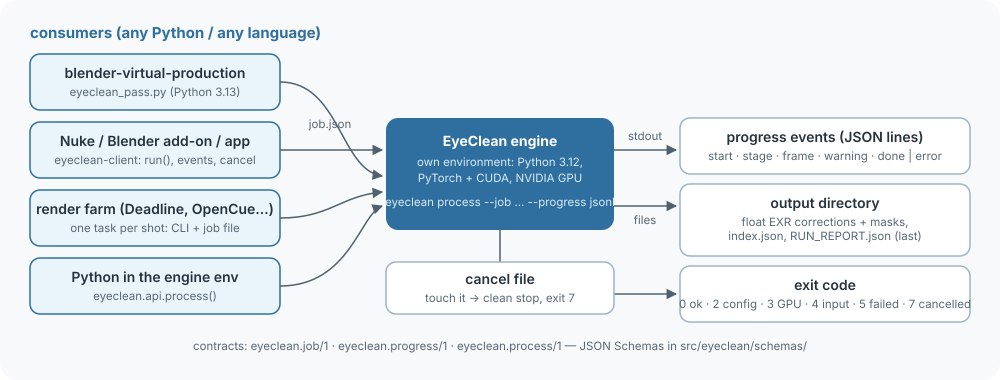
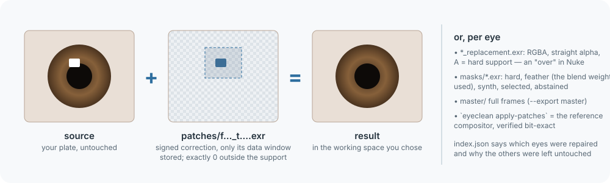

# Calling EyeClean from other software

This is the contract between EyeClean and the programs that call it: pipelines, compositing apps, render farms and
scripts.  Everything here is versioned.

| contract | what | schema |
|---|---|---|
| `eyeclean.job/1` | the job: what to process and how | [`src/eyeclean/schemas/process_job.schema.json`](../src/eyeclean/schemas/process_job.schema.json) |
| `eyeclean.progress/1` | progress events, one JSON object per line | [`progress_event.schema.json`](../src/eyeclean/schemas/progress_event.schema.json) |
| `eyeclean.process/1` | the output directory: `RUN_REPORT.json`, `patches/index.json` and the EXR layers | [`process_report.schema.json`](../src/eyeclean/schemas/process_report.schema.json), [`process_index.schema.json`](../src/eyeclean/schemas/process_index.schema.json) |
| exit codes | 0 ok · 2 configuration · 3 GPU policy · 4 unsupported input · 5 runtime failure · 6 verification failed · 7 cancelled | stable |

Within a version, fields are only ever added.  Consumers must ignore fields and event kinds they do not know.  An
incompatible change bumps the version (`eyeclean.process/2`), and the old one is documented until it is removed.



## 1. Pick an integration

| you are | use | why |
|---|---|---|
| a pipeline or app in **another Python** (Blender's, Nuke's, a 3.13 venv...) | the [`eyeclean-client`](../clients/python) package | no torch or CUDA dependency; it runs the engine as a subprocess and gives you events, typed errors and an output reader |
| a **render farm** or a shell script | the CLI with a job file | one task per shot, exit codes, JSON-lines progress on stdout |
| Python code **inside the engine's own environment** | `eyeclean.api.process()` | in-process, with a progress callback and a cancel event |
| **another language** (C++, Rust, Node) | the CLI | spawn `eyeclean process --job job.json --progress jsonl` and parse lines |

**Run EyeClean out of process unless you already live in its environment.**  The engine pins Python 3.12, PyTorch 2.14
(CUDA 13) and NVIDIA's video codec bindings.  Importing it into a host with another torch or CUDA build will not work,
and a crashed or cancelled job cannot take your host down with it.

## 2. Install the engine

```powershell
git clone <repo> eyeclean; cd eyeclean
./bootstrap.ps1                      # uv sync --frozen, face-detector weights, quick doctor (Linux: ./bootstrap.sh, untested)
uv run eyeclean models --fetch       # download the default model and verify its SHA-256
uv run eyeclean models               # where models are looked for, and which are installed
```

- **Models:** `eyeclean models --fetch` puts the default model (`eyeclean-r56.safetensors`) in the user model
  directory.  You can also download it yourself and put it in one of:
  - `$EYECLEAN_MODEL_DIR`;
  - `%LOCALAPPDATA%\eyeclean\models` (Windows) or `~/.local/share/eyeclean/models`;
  - the checkout's `models/`;
  - or pass a path with `--model`.
  The registry (`src/eyeclean/models/registry.json`) knows each released model's SHA-256 and how to run it.  A file
  with the wrong hash is refused.
- **Pointing a client at the engine:**
  - `EYECLEAN_CMD="C:/tools/eyeclean/.venv/Scripts/eyeclean.exe"`;
  - or `EYECLEAN_PYTHON=/opt/eyeclean/.venv/bin/python` (the client runs `python -m eyeclean`);
  - or put `eyeclean` on `PATH`.
- **Requirements:**
  - an NVIDIA GPU with a CUDA 13 driver and about 4 GB of free memory;
  - NVDEC for video input.
  - It is developed and tested on Windows 11 with an RTX 5080.  Linux is untested.
  - There is no CPU path.

## 3. The job (`eyeclean.job/1`)

```json
{
  "schema": "eyeclean.job/1",
  "input": "key/fg/%06d.exr",
  "output": "composite/eyeclean",
  "input_color": "linear-rec709",
  "working_color": "linear-rec709",
  "fps": "60000/1001",
  "export": ["patches", "report"],
  "exr_compression": "zip",
  "client": {"shot": "sh042", "pipeline": "my-pipeline 1.4"}
}
```

| key | meaning | default |
|---|---|---|
| `input` | video file (H.264, HEVC, AV1, VP9; 8-12 bit), or an EXR sequence: a directory, `%06d`, `####` or a glob | required |
| `output` | output directory (created; must not be the input's directory) | required |
| `model` | registry name (`eyeclean models`) or a `.safetensors` path | `$EYECLEAN_MODEL`, else the registry default |
| `input_color` | `linear-acescg`, `linear-rec709`, `rec709`, `rec709-display`, `srgb`, `panasonic-vlog-vgamut` | from a sidecar or stream metadata; otherwise it is an error |
| `input_range` | `auto`, `full`, `limited` (video) | from the stream if signalled |
| `working_color` | `linear-acescg` or `linear-rec709`: the space of every output EXR | `linear-acescg` |
| `fps` / `timestamps` | EXR sequences carry no timing: a constant rate (`24`, `"30000/1001"`, exact) or a per-frame list | required for sequences |
| `export` | any of `patches`, `report`, `preview`, `master` | `patches, preview, report` |
| `exr_compression` | output EXRs: `none`, `zips`, `zip` (lossless) | `none` |
| `max_frames` | process only the first N frames | all |
| `max_region` | one single-channel full-frame EXR; edits happen only where it is > 0 | none |
| `strength` | 0..1, scales the correction | 1 |
| `restore_mode` | `auto` takes the registry's setting for the model | `auto` |
| `progress_file`, `cancel_file` | see section 4 | none |
| `client` | free-form caller metadata, recorded in `RUN_REPORT.json` | none |

- **Precedence:** command-line flags override the job, and the job overrides the defaults.
- **Relative paths** in a job file resolve against the job file's directory.
- **Unknown keys** are an error (exit 2), so a typo can't silently fall back to a default.
- **Recording:** `RUN_REPORT.json` records the resolved job under `job.resolved`.  It is itself a valid job, so a run
  can be repeated exactly.
- **Sidecars:** a `<input>.eyeclean.json` or `sequence.eyeclean.json` sidecar next to the input may declare colour,
  range and fps once for a shot.

## 4. Running, progress and cancellation

```powershell
eyeclean process --job shot.eyeclean.json --progress jsonl
```

With `--progress jsonl`, stdout carries only JSON lines.  `--progress-file` writes the same stream to a file as well:

```text
{"schema":"eyeclean.progress/1","event":"start","t":0.0,"input":"...","output":"...","model":{"name":"eyeclean-r56","sha256":"b1a3...","restore_mode":"single"},"frames_expected":1200}
{"schema":"eyeclean.progress/1","event":"stage","t":0.9,"stage":"analysis"}
{"schema":"eyeclean.progress/1","event":"frame","t":1.1,"stage":"analysis","frame":0,"done":1,"total":1200}
...
{"schema":"eyeclean.progress/1","event":"stage","t":134.2,"stage":"render"}
{"schema":"eyeclean.progress/1","event":"frame","t":134.6,"stage":"render","frame":0,"done":1,"total":1200,"eyes_repaired":2,"eyes_tracked":2}
...
{"schema":"eyeclean.progress/1","event":"done","t":...,"summary":{"frames":1200,"eye_status_counts":{"repaired":2234,"untouched":166},...}}
```

- **The two passes:** there are two passes over the clip.
  - *Analysis* decodes the whole clip once for tracking and cut detection; it is about a quarter of the time.
  - *Render* decodes it again and writes outputs frame by frame.
  - Report progress as `(analysis_done + render_done) / (2 * total)`.
  - `total` is `null` for video until the analysis pass has counted the frames.
- **The last line** is always `done` (with the run summary) or `error` (`code`, `kind`, `message`).  The same message
  also goes to stderr.
- **Cancel:** create the `--cancel-file`.  It is checked before every frame of both passes.  The run then stops with
  exit 7 and an `error` event of kind `cancelled`.  Ctrl+C does the same.
- **Incomplete output:** a cancelled or failed output directory has no `RUN_REPORT.json`.  The report is written
  last, so **its presence is the completion marker.**  Runs are not resumable yet: rerun into a fresh or cleared
  directory.
- **One GPU, one job:** EyeClean holds the GPU (about 3.3 GB) for the whole clip.  Do not run it beside renders or other
  GPU stages.  A host that needs the GPU back can pass its own "release" file as `--cancel-file`.
- **Speed** (RTX 5080, 1080p, one face): about 2.3 frames per second end to end, i.e. 1,200 frames in about 8.6
  minutes.  Up to 4 faces per frame are processed; more are reported as a warning.

## 5. The outputs (`eyeclean.process/1`)

```text
<output>/
  RUN_REPORT.json            written last: model + SHA-256, resolved job, colour interpretation, preservation proof,
                             eye_status_counts, warnings, timings
  patches/index.json         every frame; every tracked eye with status "repaired" | "untouched", reasons, data windows
  patches/f<frame>_t<track>.exr              R,G,B = output - source (signed, working space), exactly 0 outside the support
  patches/f<frame>_t<track>_replacement.exr  R,G,B,A: the output inside the support, STRAIGHT alpha, A = hard support
  masks/f<frame>_t<track>.exr                hard, feather (the blend weight used), synth, selected, abstained
  uncertainty/f<frame>_t<track>.exr          1 - the network's reconstruction confidence (not a probability)
  master/frame_<frame>.exr                   with export "master": full-frame result (+ the source alpha)
  source_manifest.json       SHA-256 of every input file before and after (they never change), decoder, transform
  tracks.json                per-frame eye tracks, cuts
  preview.mp4, comparison.mp4                with export "preview": 8-bit viewing copies, NOT masters
```



**Applying the result is one addition.**  Each patch EXR stores only its data window, `[x0, y0, x1, y1)` in full-frame
pixels (the EXR `dataWindow`, inclusive, plus one).  In the working space:

```python
result = source.copy()
result[y0:y1, x0:x1] += correction          # correction is exactly 0 outside the hard support
```

- **Preservation:** every pixel outside the hard support is bit-identical to the decoded source.  EyeClean checks this
  on every frame and fails the run otherwise.
- **Reference compositor:** `eyeclean apply-patches <input> --patches <output>/patches --output <dir>` is the reference
  compositor and verifies itself.
- **Nuke:**
  - Read the patch (Nuke honours the data window).
  - Set its colourspace to the job's `working_color`: ACEScg or linear Rec.709, raw data.
  - `Merge (plus)` it onto the plate in the same space.
  - For the RGBA replacement, `Premult`, then `Merge (over)`.
- **Which eyes changed:** `index.json` says, per frame and eye.
  - `untouched` eyes carry `reasons` such as `no_reflection_detected`.
  - Gate anything you add on top (a new reflection, a relight) on `status == "repaired"`.
- **Eye names** are from the image's point of view: `image_left` / `image_right`.
- **The working space** is the job's `working_color`.
  - With `working_color = linear-rec709` and `linear-rec709` or `rec709` input, the correction is in the source's own
    linear primaries.
  - EXR outputs carry `eyeclean/*` string attributes (semantics, frame, working colour) and no `chromaticities`
    attribute yet.

## 6. Colour

- **Photos carry their own colour.**  For a still image (JPEG, PNG, WebP, TIFF, BMP) EyeClean reads the colour from the
  file: an ICC profile (matrix/TRC: sRGB, Display P3, Adobe RGB, ...) or a PNG cICP / sRGB chunk.  An untagged photo is
  read as sRGB, the convention for untagged images, and the report says `colour_assumed: true`.  The EXIF orientation is
  applied, and `--input-color` is ignored for photos.
- **Video and EXR sequences: declare the input's colour.**  EyeClean converts the decoded source once to FP32 linear.  That exact array is the
  preservation reference.
- **Best input:**
  - a scene-linear EXR sequence (`linear-acescg` or `linear-rec709`);
  - or the camera's own encoding where it is supported (`rec709`, `panasonic-vlog-vgamut`).
- **Not supported yet:** BT.2020, PQ, HLG and other camera log curves.  Convert them to linear ACEScg upstream (OCIO /
  `oiiotool`) and declare `linear-acescg`.
- **Video range:** limited-range video must be declared or signalled (`input_range`); EyeClean never guesses it.
- **Unsupported codecs:** ProRes, DNxHR and RAW are not decodable on NVDEC.  Export an EXR sequence or HEVC.
- **EXR compression:** EXR inputs may be uncompressed, ZIP or ZIPS.  PIZ, DWAA/B, B44 and others are refused with a
  conversion hint (`oiiotool in.exr --compression zip -o out.exr`).

## 6a. Photos

```
eyeclean fix IMG_1234.jpg [more files] [--model NAME|PATH] [--output FILE|DIR] [--keep-work]
```

- **The simplest route:** `fix` runs the full pipeline and writes `<name>.eyeclean.<ext>` next to each input (or to
  `--output`).  It prints the eyes it repaired and left untouched, the colour it used and the decode path.
- **`process` also accepts a photo.**  Its output directory then gains the photo, `<name>.eyeclean.<ext>`, listed as
  `outputs.photo` in `RUN_REPORT.json`, with the file's details under `interpretation.still`.  There is no MP4 preview.
- **Output format:**
  - JPEG in -> JPEG out, encoded on the GPU at quality 95.  EXIF (orientation reset to 1, since the pixels are written
    upright) and the ICC profile are carried over.
  - PNG in -> PNG out, 8 or 16 bit.
  - Other formats -> PNG.
- **Preservation:** outside the edit support the original decoded code values are written back.  A PNG output is
  therefore bit-identical there; a JPEG output is re-encoded as a whole (lossy).  The EXR patches (`--keep-work`, or
  `process`) remain the exact deliverable.
- **Decoding:** JPEG decodes on the GPU (nvJPEG).  Formats without a GPU decoder (PNG, WebP, TIFF, BMP, CMYK JPEG)
  decode on the CPU through PyAV and are uploaded once; all image processing stays on the GPU.  The report records the
  path (`interpretation.still.decode`).
- **Not yet:** HEIC / HEIF and AVIF (planned), Ultra HDR gain maps (the SDR base is processed and the output has no
  gain map; the run warns), photo output in WebP / TIFF / HEIC.

## 7. Python API (engine environment)

```python
import threading
from eyeclean.api import process, Cancelled

stop = threading.Event()
res = process("interview.mp4", "out/", input_color="rec709", input_range="limited",
              on_progress=lambda e: e["event"] == "frame" and print(e["stage"], e["done"], e.get("total")),
              cancel=stop)                       # or a callable, or a file path
print(res.summary["eye_status_counts"], res.report_path)
res = process(job="shot.eyeclean.json", max_frames=48)   # a job, with keyword overrides
```

- **Options:** keyword arguments are the job keys.
- **Errors:** `InputError`, `ConfigError`, `GpuPolicyError`, `Cancelled` and `RuntimeError`.
- **Embedding:**
  - The call holds the GPU for the clip.
  - It runs a strict GPU audit, so do not do CPU tensor work inside `on_progress`.
  - It installs a file-access audit hook, which Python cannot remove.
  - In a long-lived host, prefer one process per job, i.e. the client.

## 8. `eyeclean-client` (any Python ≥ 3.9)

```python
from eyeclean_client import run, RunOutput, EyeCleanCancelled

res = run({"input": "shot/fg/%06d.exr", "output": "shot/eyeclean", "input_color": "linear-rec709", "fps": "24"},
          on_event=my_progress_bar.update, cancel=stop_event)
out = RunOutput(res.output)
for fr in out.frames():
    for eye in fr.eyes:
        if eye.status == "repaired":
            corr = out.read(eye.patch)            # numpy R, G, B (needs numpy); eye.data_window = [x0, y0, x1, y1)
```

- **Dependencies:** none at runtime.  numpy is needed only to read EXRs (the reader handles what EyeClean writes: none,
  ZIP and ZIPS).
- **Errors:** exit codes map to `EyeCleanConfigError`, `EyeCleanGpuError`, `EyeCleanInputError`,
  `EyeCleanCancelled` and `EyeCleanError`.
- **Tested** under Python 3.12 and 3.13.

## 9. Recipes

- **blender-virtual-production-experiment:** [`docs/integrations/blender-virtual-production.md`](integrations/blender-virtual-production.md).
- **Render farm** (Deadline, OpenCue, Tractor):
  - Submit one task per shot, not per frame chunk: tracking needs the whole clip.
  - The task runs `eyeclean process --job <shot>.eyeclean.json --progress jsonl`.
  - Parse `done/total` from `frame` lines for the progress bar.
  - Exit 0 is success.  Exit 4 means the input needs fixing (don't retry).  Exits 3, 5 and 7 are retryable.
  - Pin one job per GPU (for example `CUDA_VISIBLE_DEVICES`).
- **Blender add-on:**
  - An operator writes the job, starts `eyeclean_client.run` in a thread and polls a queue from a modal timer to drive
    the progress bar.
  - Its cancel button sets the event.
  - Blender's Python never imports torch.
- **Nuke:**
  - A Python panel runs the client in a thread (as for Blender).
  - Then it builds `Read` nodes over `patches/f%06d_t000.exr` and a `Merge (plus)`, or per-eye Reads from
    `index.json`.
- **A service:**
  - Wrap the CLI behind your queue with one worker per GPU.
  - The job file is the request; `RUN_REPORT.json` plus `index.json` is the response.

## 10. Not yet in the interface

These are known gaps, in rough order of value:
- **Frame ranges:** only `max_frames` exists, so there is no start frame.
- **Masks per frame:** `max_region` is one full-frame EXR for the whole clip.
- **External eye tracks:** a caller with its own tracks (limbus fits, facial capture) cannot yet pass them in to replace
  the built-in face detector.
- **Resuming** after a cancel.
- **Device selection:** device 0 is always used.
- **EXR metadata:** output EXRs carry no `chromaticities` attribute.
- **Input compressions:** PIZ / DWA EXRs, ProRes and DNxHR input; HEIC / AVIF photos.
- **Video colour from the stream** (BT.2020, PQ, HLG) and video-in / video-out with audio: in progress.
- **Hardware:** no CPU fallback, and no GPU other than NVIDIA.
